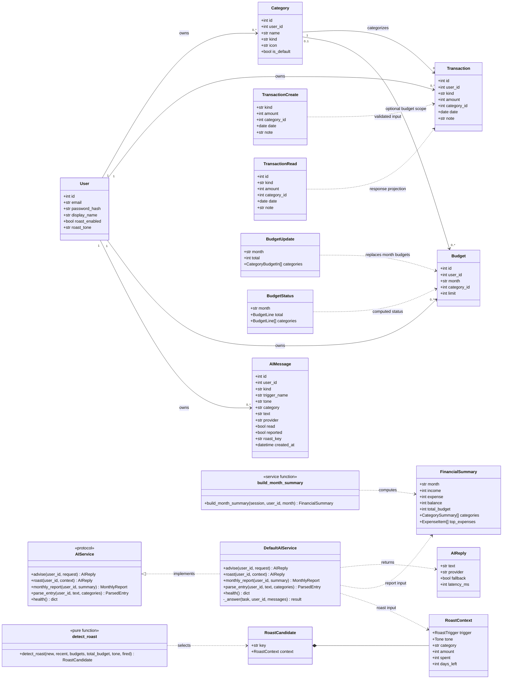
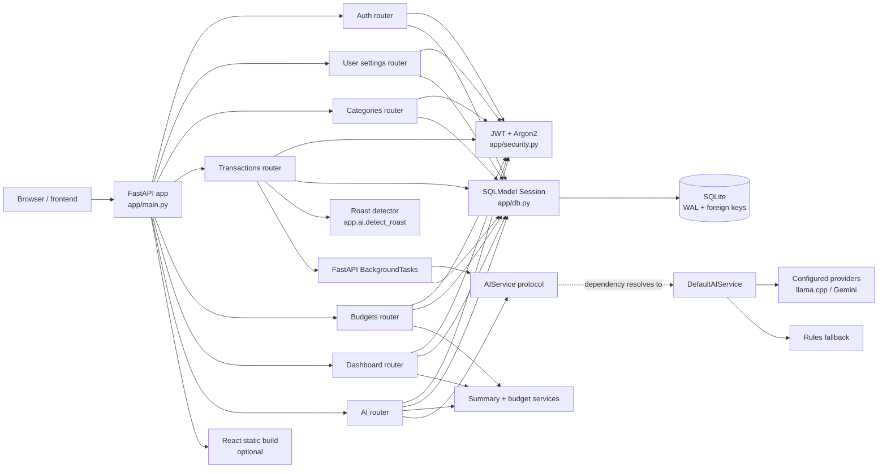
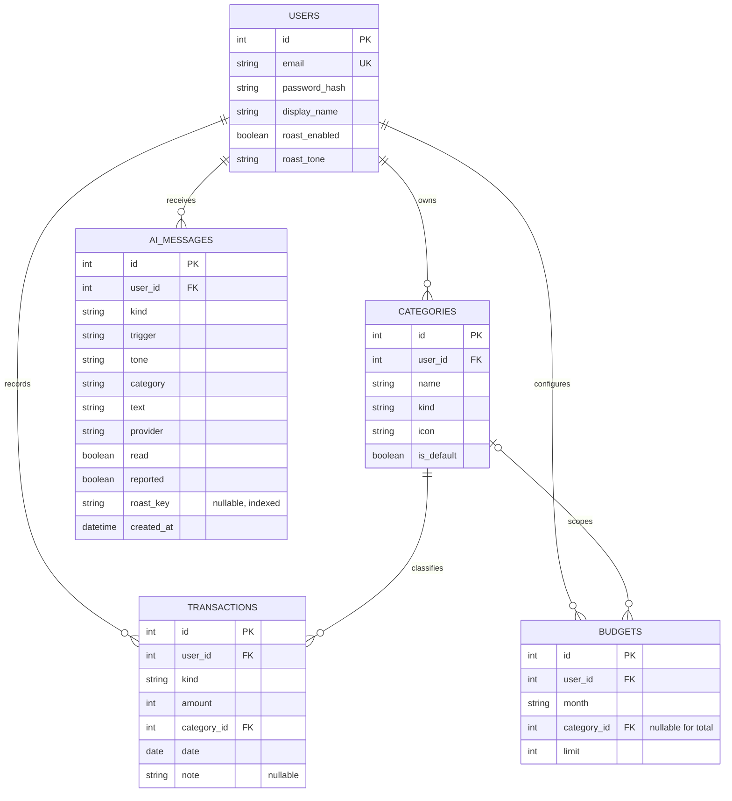
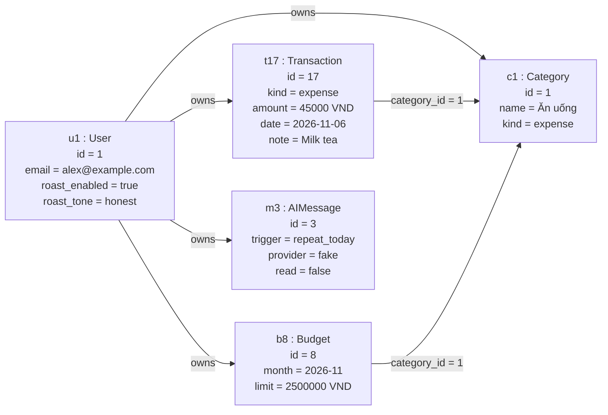
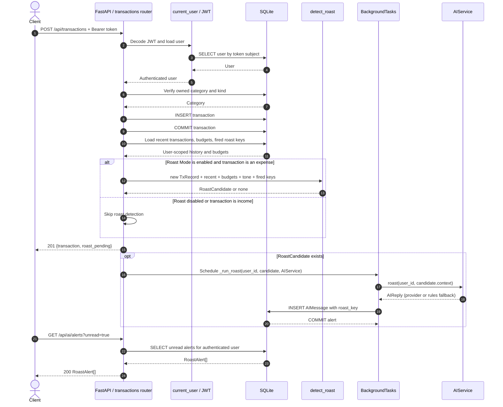
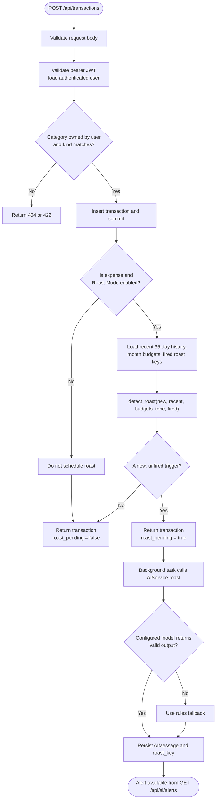

# WalletWarden Backend Diagrams

These diagrams are based on the backend source: `app/main.py`, `app/api/`,
`app/models.py`, `app/schemas/`, `app/services/`, and `app/ai/`.

## Open in draw.io / diagrams.net

1. Open diagrams.net and create or open a diagram.
2. Choose **Arrange → Insert → Mermaid** (in some versions: **Insert → Advanced → Mermaid**).
3. Copy one complete Mermaid code block below, including its first `flowchart`,
   `classDiagram`, `erDiagram`, or `sequenceDiagram` line, into the editor.
4. Insert it, then repeat for each diagram. They are separate diagrams so each
   can be rearranged and styled independently.

The object view is expressed as a Mermaid flowchart because Mermaid does not
define a dedicated object-diagram syntax.

## 1. Class diagram

Shows the persisted SQLModel entities, the main Pydantic contracts, and the
backend's key service interfaces. Field and dependency associations reflect how
the current routes and services use those types; they are not Python ORM
relationship declarations.

## 2. Component diagram

Shows runtime routing and dependency direction. The React build is served only
when `frontend/dist` exists; it is not part of API request handling.

## 3. ERD

Shows the five persisted tables and their foreign keys. A `budgets.category_id`
of `NULL` represents a whole-month budget; a non-null value scopes it to one
category.

## 4. Object diagram (example data snapshot)

This is an illustrative object graph for one user. Example values are not
pre-seeded database rows. Lines show the current ownership/category references.

## 5. Sequence diagram: saving an expense and generating a roast

Roast detection is done after the transaction commit. The API response contains
`roast_pending`; the roast generation and alert persistence run as a background
task after the response is sent.

## 6. Flowchart: transaction request and roast decision

